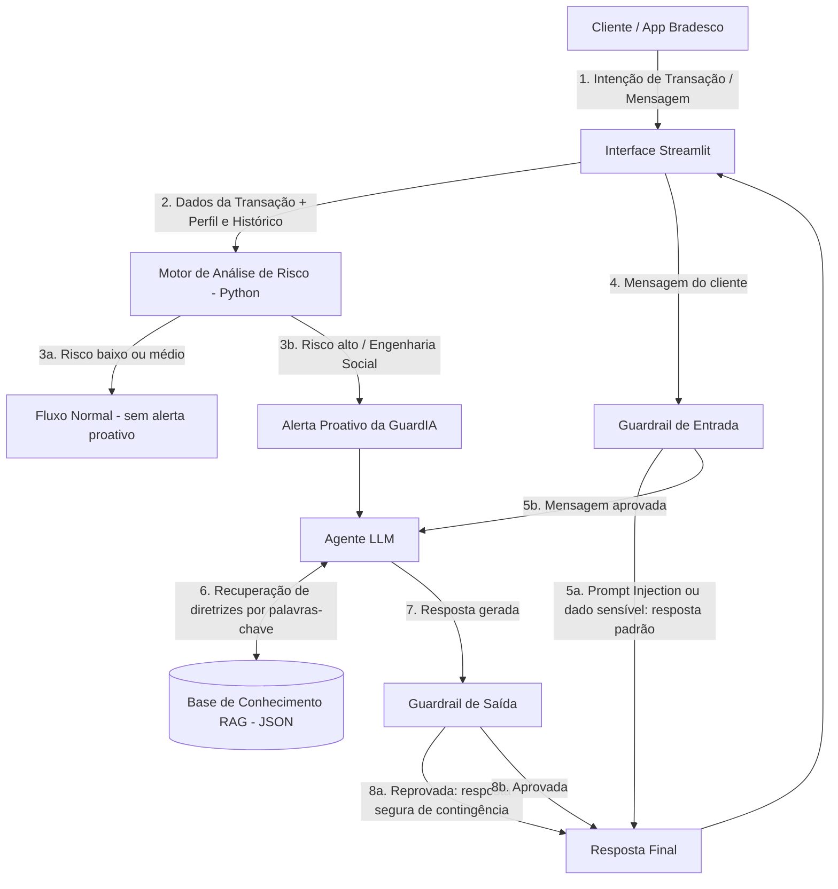

# Documentação do Agente

## Caso de Uso

### Problema
> Qual problema financeiro seu agente resolve?

Golpes de engenharia social (como o golpe do falso funcionário, falsa central de atendimento, engenharia social via WhatsApp e manipulação de PIX agendado) exploram a vulnerabilidade do comportamento humano por meio de manipulação psicológica, urgência e autoridade. Os sistemas bancários tradicionais e modelos de detecção de fraude atuam majoritariamente de forma reativa — bloqueando a transação após o sinal de alerta ou auxiliando o cliente somente após o prejuízo efetuado. Isso gera perdas financeiras expressivas aos clientes, desgaste da reputação institucional e custos operacionais com contestações e suporte.

### Solução
> Como o agente resolve esse problema de forma proativa?

O agente atua como um "Guardião Comportamental Proativo e Consultivo", intervindo no momento pré-transação (em tempo real) ao identificar padrões atípicos de comportamento e risco de engenharia social.

A solução atua da seguinte forma:

Detecção Preditiva de Risco (Análise de Dados em Python): Monitora variáveis contextuais da transação: valor incompatível com o histórico do cliente, chave PIX recém-cadastrada, horário atípico e chamada ativa simultânea. No protótipo, esses sinais são simulados pela interface; em produção, poderiam ser complementados por tempo de digitação, padrão de navegação e geolocalização.

Intervenção Contextual e Educativa (IA Generativa): Em vez de apenas emitir um bloqueio genérico, o agente inicia um diálogo amigável, contextualizado e educativo na interface do aplicativo bancário. Ele explica por que aquela transação acendeu um alerta (ex.: "Notamos que você está tentando transferir para uma conta nova enquanto recebe uma chamada externa. Esse é o padrão do golpe da Falsa Central").

Cocriação e Validação Segura (Cibersegurança & Anti-alucinação): O agente orienta o cliente a validar a situação pelo canal oficial (app ou número do verso do cartão), impedindo o envio impulsivo do dinheiro. Para garantir confiabilidade total, o agente utiliza RAG (Retrieval-Augmented Generation) conectado à base de conhecimento oficial de segurança do Bradesco e Guardrails de entrada e saída contra ataques de Prompt Injection (tentativas do golpista de usar o chat para burlar o sistema).

### Público-Alvo
> Quem vai usar esse agente?

Clientes Correntistas do Banco Bradesco (Pessoas Físicas): Especialmente focado em perfis com maior vulnerabilidade digital (como idosos ou novos usuários de canais digitais) e clientes que realizam transações de médio a alto valor via PIX/TED no dia a dia.

Equipes Internas de Prevenção à Fraude e Segurança da Informação (Público Secundário/Operacional): Analistas do banco que recebem os relatórios consolidados e métricas geradas pela IA sobre novos padrões de engenharia social detectados durante as conversas.

---

## Persona e Tom de Voz

### Nome do Agente
GuardIA Bradesco

### Personalidade
> Como o agente se comporta? (ex: consultivo, direto, educativo)

Proativo e Protetor: Não espera o cliente pedir ajuda; intervém no momento exato de um comportamento de risco com calma e assertividade.

Empático e Não-Julgador: Entende que vítimas de engenharia social estão sob forte pressão emocional ou manipulação; nunca usa tom de pavor, censura ou acusação.

Educativo e Consultivo: Transforma um alerta de segurança em um momento de aprendizado, explicando o porquê da suspeita de forma didática e cocriando uma decisão segura junto com o cliente.

Firme em Relação às Regras de Segurança: É amigável, mas intransigente quanto à proteção do patrimônio do usuário.

### Tom de Comunicação
> Formal, informal, técnico, acessível?

Humano, Acessível e Direto.
A linguagem evita jargões técnicos de TI e cibersegurança (como "phishing", "prompt injection" ou "firewall"). Utiliza termos simples do cotidiano financeiro do cliente. O tom transmite a serenidade de um especialista de confiança do Bradesco ao lado do usuário.

### Exemplos de Linguagem
Saudação (Intervenção Proativa):

"Olá, [Nome]! Notei que você está prestes a realizar um PIX de valor alto para uma conta nova. Antes de confirmar, posso conversar rapidamente com você sobre esta transferência?"

Confirmação e Condução Educativa:

"Compreendido! Para sua segurança, me ajude a checar um detalhe: você recebeu alguma ligação ou mensagem em nome do Bradesco pedindo para fazer essa transferência agora? Lembre-se: o banco nunca pede PIX de teste ou transferência para cancelamento de conta."

Erro/Limitação e Redirecionamento Seguro:

"Por motivos de segurança, não consigo alterar seus limites de transação ou cancelar cartões diretamente pelo chat. Caso precise dessas ações, posso te direcionar com um clique para o menu seguro de Segurança do App ou conectar você com nossa Central Oficial."

---

## Arquitetura

### Diagrama

### Componentes

| Componente | Descrição |
|------------|-----------|
| **Interface** | **Streamlit App**: Prototipagem da interface interativa simulando a tela do aplicativo mobile do Bradesco, onde o cliente inicia uma transferência PIX e interage com o modal de alerta proativo do agente. |
| **Motor de Análise de Risco (Python)** | **Python + Pandas**: módulo que calcula um *Score de Risco* (0 a 100) pré-transacional por regras ponderadas: valor comparado ao padrão do cliente (mediana das saídas em `transacoes.csv`), chave PIX nova, horário noturno e chamada ativa. Faixas: baixo (<30), médio (30-49) e alto (≥50); só o nível alto aciona o alerta proativo. *Evolução prevista: modelo de ML (Scikit-Learn).* |
| **LLM (Orquestrador Generativo)** | **GPT-4o-mini (OpenAI API)**, configurável pela variável `MODEL_NAME` do `.env`: Modelo generativo responsável pela condução do diálogo empático, consultivo e focado na desconstrução de táticas de engenharia social com o cliente. |
| **Base de Conhecimento (RAG)** | **RAG simples sobre JSON** (`data/base_conhecimento_seguranca.json`): diretrizes de segurança por tipo de golpe (Falsa Central, PIX Agendado, acesso remoto, dados sensíveis, pós-golpe/MED). A recuperação usa palavras-chave e traz as 2 diretrizes mais relevantes. *Evolução prevista: banco vetorial (ChromaDB/FAISS) com as cartilhas oficiais.* |
| **Validação (Cibersegurança & Guardrails)** | **Guardrails em Python (entrada e saída)**: na entrada, bloqueia tentativas de *Prompt Injection* e o envio de dados sensíveis (senha, CPF, cartão) antes de chegar ao modelo; na saída, reprova respostas que peçam dados sensíveis, autorizem transações ou tragam telefones inventados, substituindo-as por uma orientação segura da base. *Evolução prevista: Guardrails AI / NeMo.* |

---

## Segurança e Anti-Alucinação

### Estratégias Adotadas

- [x] **Grounding via RAG Estrito:** O agente responde exclusivamente com base em dados verificados da base de conhecimento de segurança do Bradesco e normativas oficiais do Banco Central sobre transações e PIX.
- [x] **Transparência e Citação de Fontes:** Toda orientação de segurança inclui a referência da norma ou orientação oficial do banco (ex.: *"Conforme as orientações de segurança do Bradesco..."*).
- [x] **Admissão de Incerteza e Transbordo Humano:** Quando o agente não possui dados suficientes para avaliar o risco ou responder a uma dúvida específica, ele admite explicitamente a limitação e redireciona o cliente para a Central de Atendimento Oficial ou agência.
- [x] **Filtros de Guardrail Anti-Prompt Injection:** Camada de sanitização de entradas que impede que um golpista, em posse do celular do usuário, envie comandos no chat para burlar o agente ou forçar a liberação do PIX.
- [x] **Zero Recomendação sem Validação Contextual:** O agente nunca sugere cancelamento de contas, transferências para "contas seguras de teste" ou alterações operacionais de saldo.

### Limitações Declaradas
> O que o agente NÃO faz?

- **Não realiza bloqueios ou cancelamentos definitivos de contas e cartões:** O agente orienta e alerta o cliente, mas a execução de bloqueios definitivos permanece restrita aos fluxos tradicionais de segurança e autenticação forte do banco.
- **Não solicita senhas, códigos PIN ou validações de Chave de Segurança (Token) via chat:** O agente nunca pedirá dados sensíveis de acesso durante a conversa.
- **Não realiza movimentações financeiras nem autoriza transações diretamente:** O agente atua na camada consultiva e de alerta; a execução do PIX ou TED continua sendo uma decisão do cliente via aplicativo.
- **Não concede recomendações de investimento nem análise de carteira:** O escopo do agente é estritamente focado em prevenção a fraudes, segurança cibernética e orientação preventiva de transações.